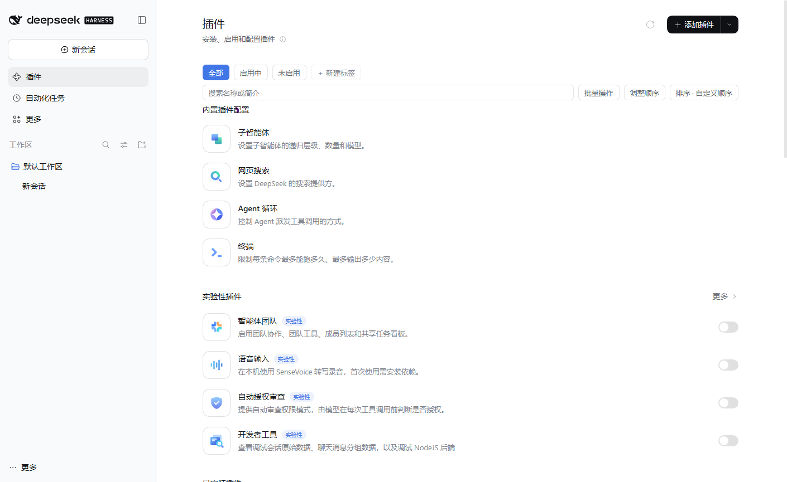
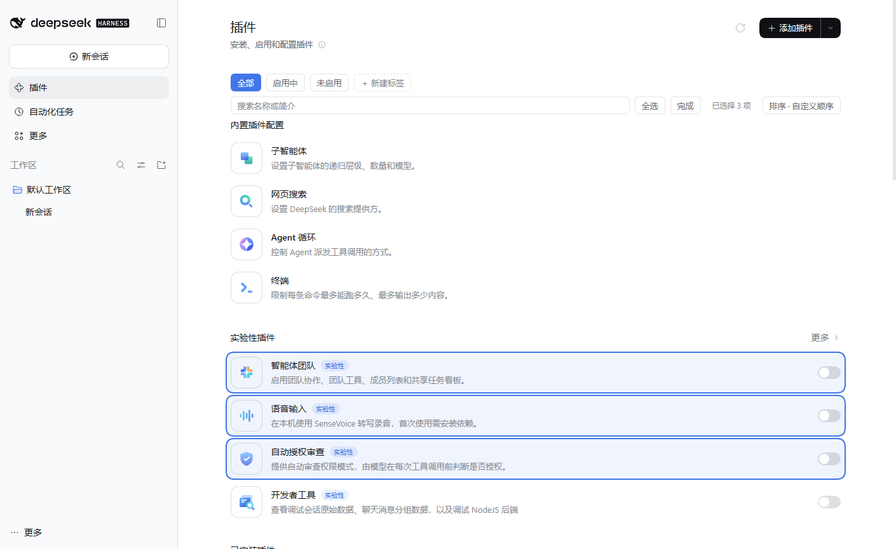
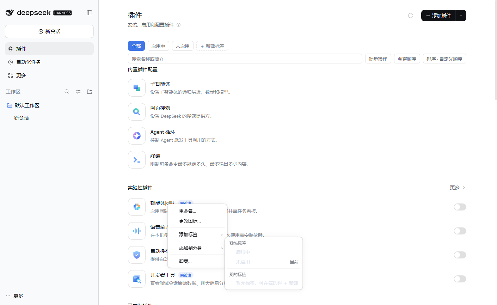

# 插件管理增强 · plugin-manager-plus

给 DeepSeek Harness 原生「插件」页加一层增强：**标签筛选、搜索、排序与拖拽、批量操作、名称/简介/图标改写、AI 生成、快速卸载**，并把同一套能力通过 **Surface 契约**复用到其它插件列表页面（如分身管理）。

纯展示层叠加：不改原生 DOM 结构、不移动节点，只写文本与样式；禁用插件后原生页面即刻恢复原样。



> 非官方第三方插件，与 DeepSeek 官方无关。当前版本 **v0.9.0**。

---

## 功能

### 筛选与搜索

- 标签筛选条：**全部 / 启用中 / 未启用** + 自定义标签 + 「＋新建」。
  - 「启用中 / 未启用」是**派生标签**：读卡片内启用开关的 `aria-checked` 自动归类，不需要手动维护，也不能删除或改名。
  - 「内置 / 实验性 / 已安装」分组标签自 v0.9 起移除——原生页面本身已按这三个分区展示。
- 搜索框：名称按严格子串匹配（原生名与自定义名都参与），简介按模糊子序列匹配；与当前标签筛选取交集。

### 排序与手动拖拽

- 「排序」下拉：手动顺序 / 名称 A→Z / 名称 Z→A / 启用优先 / 版本高→低 / 最近出现。
- 「调整顺序」进入拖拽模式：整卡可拖，落点画插入指示线、松手才提交，卡片之间空隙也能放置；顺序按分区保存（`all` / `tag:<id>`）。
- 拖动期间面板抑制原生 hover 背景，结束后不会残留高亮。

### 批量操作

- 工具栏「批量操作」进入后分裂为「全选」与「完成」。
- 点击卡片多选，右键出批量菜单：**批量添加标签 / 批量添加到分身 / 批量卸载**（卸载带确认，失败项保留选中）。
- 批量只作用于「仍选中且当前可见」的卡片；工具栏有 `aria-live` 的「已选择 N 项」计数。

### 卡片编辑

- 重命名：自定义显示名称与简介，原名保留为小字；改名后立即反映到卡片。
- 图标：右键「更改图标…」打开图标库，内置图标与已上传图标平铺同一网格，支持 **png / jpeg / webp / gif / svg / ico** 单图或 **zip** 批量上传；内置与上传图标都可多选删除。
- 卸载：右键「卸载…」调用原生卸载，仅对可卸载插件出现。

### AI 生成名称与简介

- 重命名弹窗底部「一键生成」：**默认直接使用 DSH 当前默认模型**，无需单独填 API Key。
- 可编辑五段式提示词（角色 / 原始信息 / 要求 / 输出格式 / 自审），支持 `{name}`、`{description}`、`{existingNames}` 占位符，可恢复默认。
- host 侧多轮自检：合法 JSON、长度、名称不与其它插件重复，不合格把问题反馈给模型重答（最多 3 轮）。
- 模型选择：可跟随默认模型，或指定 provider/model 并使用其最低推理档；`deepseek-official` 在凭证可用时优先走直连 API，失败静默回退 DSH 原生调用。
- 生成中提示「AI 正在后台生成…」，成功提示「插件「旧名」已重命名为「新名」」；**生成期间关闭弹窗不会取消后台任务**。
- 也可显式配置 OpenAI 兼容端点（`config.ai` 或 `PMP_AI_*` 环境变量），详细见 [REFERENCE](docs/REFERENCE.md#ai-代理配置)。

### 右键菜单与键盘

- 菜单项：重命名… / 更改图标… / 添加标签 ▸ / 添加到分身 ▸ / 卸载…，越界自动翻转。
- 完全键盘可用：`↑`/`↓` 移动、`→`/`Enter` 展开子菜单、`←` 返回、`Esc` 关闭整个菜单；菜单打开不预亮首项。
- 点击菜单外部第一次只关闭菜单，不会误触下层卡片。

### 安装防自动启用

通过原生安装入口（含市场一键安装）装好的插件默认处于**关闭**状态，避免装完即激活。

### Surface 契约与「添加到分身」

- 任何页面按 [Surface 契约 v1](docs/Surface契约-v1.md) 标注 `data-plugin-surface` / `data-plugin-caps` 等属性，即可复用本插件的筛选、改名、图标、排序、批量等能力；能力按 `caps` 裁剪。
- 原生插件页是隐式 surface，零适配。
- 「添加到分身」读取分身管理插件的实例列表：运行中或已安装的分身置灰并标注原因，其余点击即添加（添加后需重启该分身生效）。

---

## 兼容性

| 项目 | 说明 |
| --- | --- |
| DSH Desktop | 在 **0.2.1-rc.5**（Windows 桌面端）上开发与验证 |
| 运行环境 | DSH Web 客户端（`platform: web`），无第三方运行时依赖 |
| 浏览器 | Chromium / Edge 内核（随 DSH 桌面端） |
| 平台 | 主要验证 Windows；依赖 DSH 私有插件 API 与 DOM 结构，其它版本可能失效 |

> 本插件使用了 DSH 未公开的插件加载与 DOM 结构；DSH 升级若改动这些结构，插件可能需要跟进适配。

---

## 安装

本插件未发布到 npm，通过 DSH profile 的本地 `link:` 依赖安装。以 Windows 默认 profile 为例：

1. 关闭 DSH，克隆仓库：

   ```bash
   git clone https://github.com/zefferry/dsh-plugin-manager-plus.git
   ```

2. 编辑 `%USERPROFILE%\.dsh\profiles\desktop\package.json`：
   - 在 `dependencies` 中加入
     `"@local/dsh-plugin-manager-plus": "link:<克隆目录>"`（路径用正斜杠，如 `link:E:/tools/dsh-plugin-manager-plus`）；
   - 把 `"@local/dsh-plugin-manager-plus"` 追加到 `dsh.profile.bundles` 数组。

3. 在 profile 的 `node_modules\@local\` 下创建指向克隆目录的 junction：

   ```bat
   mkdir "%USERPROFILE%\.dsh\profiles\desktop\node_modules\@local"
   mklink /J "%USERPROFILE%\.dsh\profiles\desktop\node_modules\@local\dsh-plugin-manager-plus" "<克隆目录>"
   ```

4. 重启 DSH。

> 若使用非默认 `DSH_HOME` 或其它 profile，把上面的 `.dsh/profiles/desktop` 换成正在使用的 profile 目录即可。

卸载：关闭 DSH，移除上述依赖与 bundle 声明、删除 junction，重启即恢复原生页面；状态文件在 `$DSH_HOME/plugin-manager-plus/state.json`，可手动删除。

---

## 使用

### 筛选条与工具栏



从左到右：标签 pills（全部 / 启用中 / 未启用 / 自定义标签 / ＋新建）→ 搜索框 → 批量操作 → 调整顺序 → 排序。

### 右键菜单



### 手动排序

点「调整顺序」进入拖拽模式，拖动任意卡片到目标位置松手即可；再次点击「调整顺序」退出。退出后 `draggable` 与把手会被清理。

### AI 生成

在重命名弹窗底部点「一键生成」。未配置 AI 时按钮禁用并显示「AI 未配置」；默认模型不可用时状态行会说明原因。详细配置与多轮校验规则见 [REFERENCE](docs/REFERENCE.md#ai-代理配置)。

---

## 状态与数据

| 数据 | 位置 |
| --- | --- |
| 标签、分区顺序、名称/简介/图标覆盖、AI 提示词、模型选择 | `$DSH_HOME/plugin-manager-plus/state.json` |
| 上传的图标 | `$DSH_HOME/plugin-manager-plus/icons/` |
| AI 失败诊断（一行 JSON，权限 0600） | `$DSH_HOME/plugin-manager-plus/ai-error.log` |

状态写入使用原子替换 + 版本 CAS；文件损坏会备份为 `state.json.bak-<时间戳>` 并以空状态继续。

---

## 项目结构

```
plugin-manager-plus/
├── package.json            # DSH 插件清单（bundle patch + web client）
├── cordis.patch.yml        # 把插件插入 bundle
├── host/index.js           # 状态存储、HTTP 路由、AI 代理、图标库
├── client.js               # 浏览器端全部 UI（纯 DOM，无构建步骤）
├── locale/{zh,en}.json     # 插件列表里的标题与描述
├── assets/icon.svg         # 插件图标
├── docs/
│   ├── REFERENCE.md        # 完整参考（功能明细、HTTP 接口、状态 schema、AI 配置、限制）
│   ├── Surface契约-v1.md    # Surface 契约定义
│   └── screenshots/        # 截图
├── CHANGELOG.md
├── LICENSE
└── README.md
```

---

## 已知限制（摘要）

- 「配置条目卡」没有启用开关：只支持改名称，不参与状态筛选，也不能改图标。
- 状态筛选下隐藏「调整顺序 / 排序」：状态视图跨三个分区，无法表达分区手顺。
- 跨窗口同步是 2.5 秒轮询，不是实时推送。
- 图标库上限 100 张；单图 ≤512KB，zip ≤8MB / ≤40 张。
- 手动排序模式下卡片 `:hover` 背景会被抑制（这是为消除拖动残留高亮做的取舍）。
- AI 输出质量取决于所接模型；推理强度由模型元数据决定，无档位时不下发该参数。
- 体积：`client.js` 219,105 B + `host/index.js` 89,267 B ≈ 301 KiB。

完整限制与行为边界见 [REFERENCE](docs/REFERENCE.md#已知限制)。

---

## 开发

- 无构建步骤：`client.js` 由 DSH 的 `window.__ModuleLoader__` 直接加载，`host/index.js` 由 Cordis 加载。
- 修改后重启 DSH 生效；提交前至少执行：

```bash
node --check client.js
node --check host/index.js
```

- 维护者内部测试（Node DOM 垫片 + 真实 desktop host + Edge headless E2E）未随本仓库发布；本仓库只包含运行时代码与文档。

---

## 更新日志

见 [CHANGELOG.md](CHANGELOG.md)。

## 许可

MIT License，见 [LICENSE](LICENSE)。

---

## 致谢

- 由 [DeepSeek Harness](https://github.com/deepseek-ai) 的插件机制承载；本项目为第三方增强，非官方组件。
